<div align="center">

<a href="https://azimuth-nsa.vercel.app/">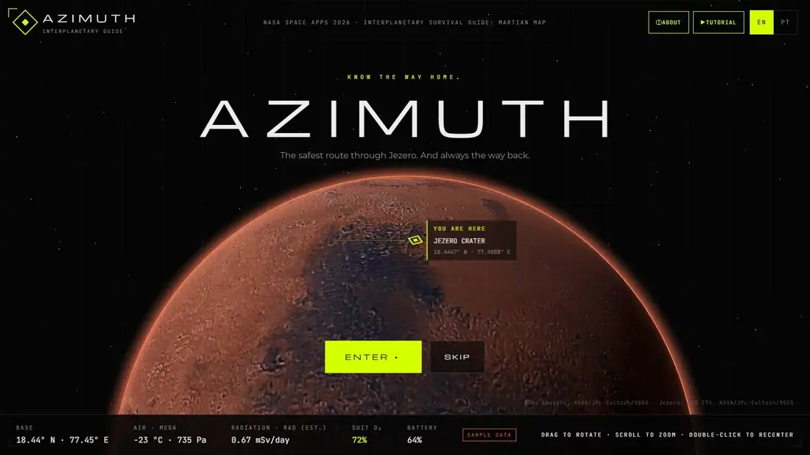</a>

# AZIMUTH

### Interplanetary Guide

**Know the way home.**

A layered map of Jezero Crater that shows a Mars astronaut the safest route, and always the way back.

[](https://azimuth-nsa.vercel.app/)
[](https://youtu.be/i6_lxfgYrVU)
[](https://www.spaceappschallenge.org/2026/find-a-team/cata-vento/)


[The idea](#the-idea) · [Video](#video) · [Tour](#tour) · [NASA data](#nasa-data) · [How it works](#how-it-works) · [The AI](#the-ai-that-never-invents-a-number) · [Run it](#run-it) · [Team](#team) · [Português](#-em-português)

</div>

---

## The idea

An astronaut walking on Mars has to answer three questions at the same time. Today that means separate maps and calculations done by hand. Azimuth answers all three on one screen.

| | Question | How Azimuth answers |
|:-:|---|---|
| **01** | **Can I go this way?** | Reads terrain, slope, hazards and surface temperature along the exact route, from orbital NASA data. |
| **02** | **Will my suit hold?** | Checks oxygen, battery and the suit's temperature range against the walk. A problem becomes an alert at the exact spot, and the alert says *what to do*. |
| **03** | **How do I get back?** | Rescue mode, one tap from any screen: the way home, the point of no return and the nearest shelter. |

Built in one weekend (14–15 November 2026) by team **Cata-vento** for the [NASA Space Apps Challenge 2026](https://www.spaceappschallenge.org/2026/challenges/interplanetary-survival-guide-martian-map/), challenge *Interplanetary Survival Guide: Martian Map*.

> **Why Jezero?** An ancient lake with a river delta, one of the best places on Mars to look for signs of past life, and the area Perseverance has explored since 2021. Tools such as Mars Trek are built for regional and global views. Azimuth is built for the few kilometres of a single Marswalk.

## Video

<div align="center">

<a href="https://youtu.be/i6_lxfgYrVU">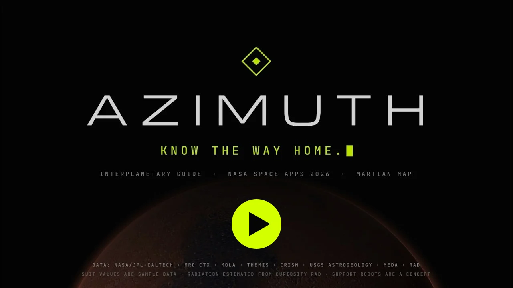</a>

**[▶ Watch the 30-second pitch on YouTube](https://youtu.be/i6_lxfgYrVU)**

</div>

### The whole mission in 20 seconds

Recorded on the live site. With only 34% oxygen, Azimuth plans the route, follows the walk, stops the astronaut **before** the point of no return, and Rescue shows the way home.

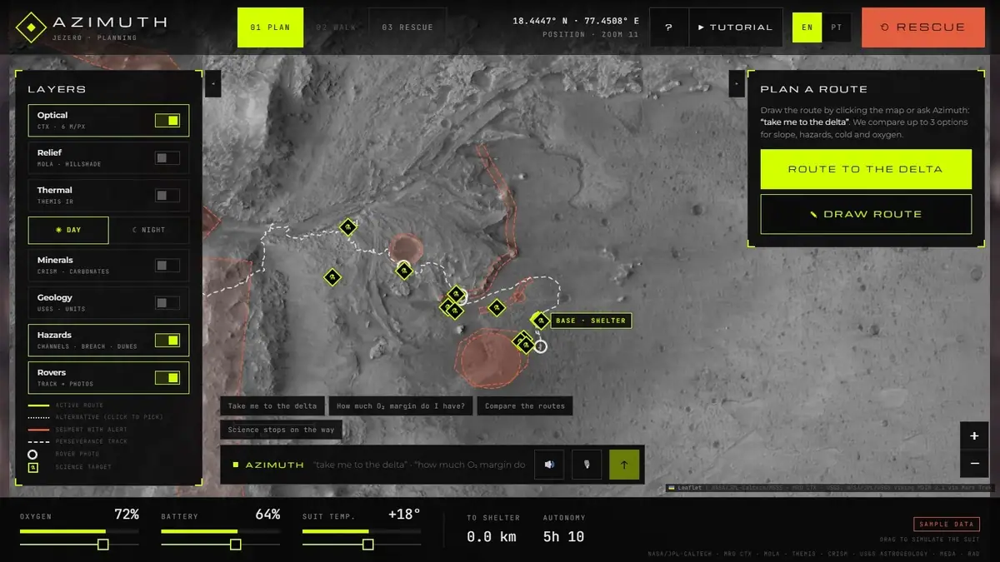

## Tour

### 01 · Plan

Draw a route on the map, or ask for one. Azimuth compares up to three options side by side (**safest**, **balanced**, **fastest**) with distance, time, oxygen left after the round trip and number of alerts.

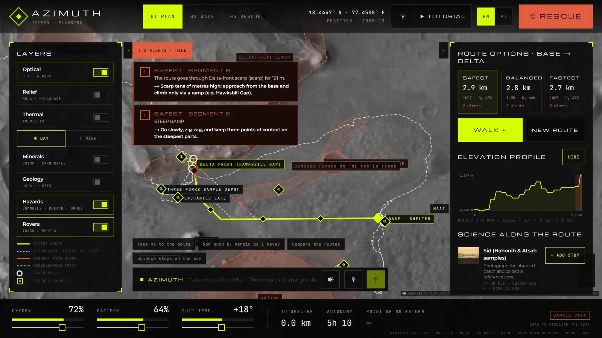

For the demo mission, base → delta front (Hawksbill Gap), by day:

| Route | Distance | Time | O₂ left after the round trip | Alerts |
|---|:-:|:-:|:-:|:-:|
| **Safest** | 2.9 km | 1h07 | 45% | 2 |
| **Balanced** | 2.8 km | 1h05 | 46% | 2 |
| **Fastest** | 2.7 km | 1h03 | 47% | 3 (adds a channel) |

<table>
<tr>
<td width="50%">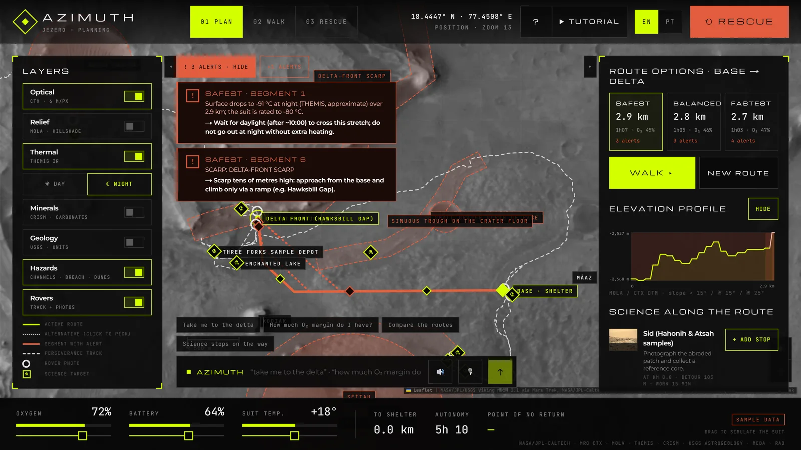</td>
<td width="50%">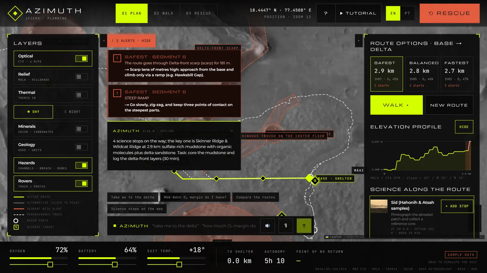</td>
</tr>
<tr>
<td><b>Day or night changes the decision.</b> At night the ground drops to about −91 °C and the suit is rated to −80 °C, so the whole route turns red: <i>"Wait for daylight."</i></td>
<td><b>Science along the way.</b> 11 science targets, most of them real Perseverance sample sites. Add one as a stop and its working time is charged to your oxygen.</td>
</tr>
</table>

### 02 · Walk

A mission clock runs, oxygen and battery drain, and the panel shows what is ahead next to the **real Perseverance photo** taken closest to the next segment.

<table>
<tr>
<td width="50%">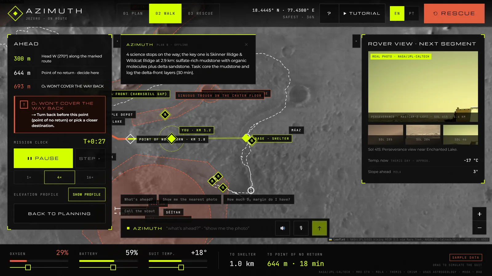</td>
<td width="50%">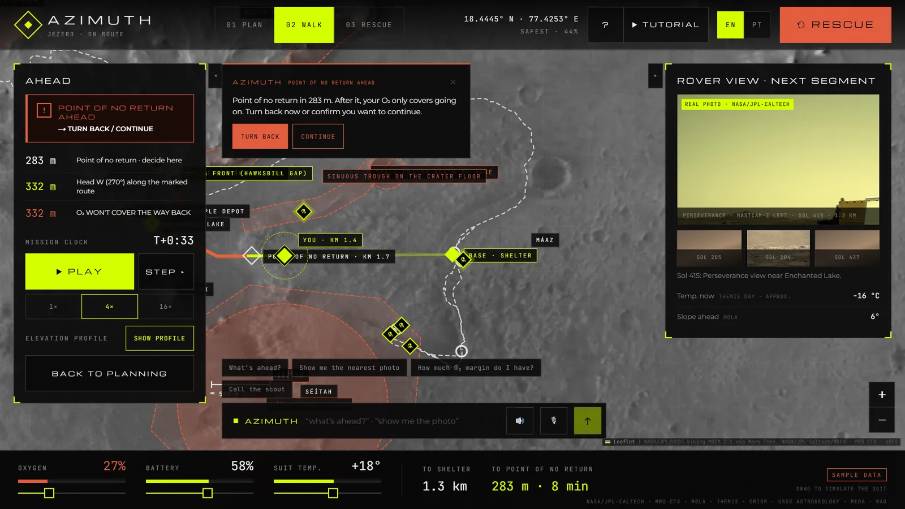</td>
</tr>
<tr>
<td><b>On route.</b> Position, headings, upcoming hazards, temperature and slope ahead, at 1×, 4× or 16× speed.</td>
<td><b>Point of no return.</b> The simulation pauses 300 m before it and asks: turn back, or continue?</td>
</tr>
</table>

### 03 · Rescue

One big button, on every screen. The interface turns salmon and shows only what matters: the way back, the oxygen it takes with a safety margin, and the nearest shelter. Support robots are a concept, and calling one **always** needs the astronaut's confirmation.

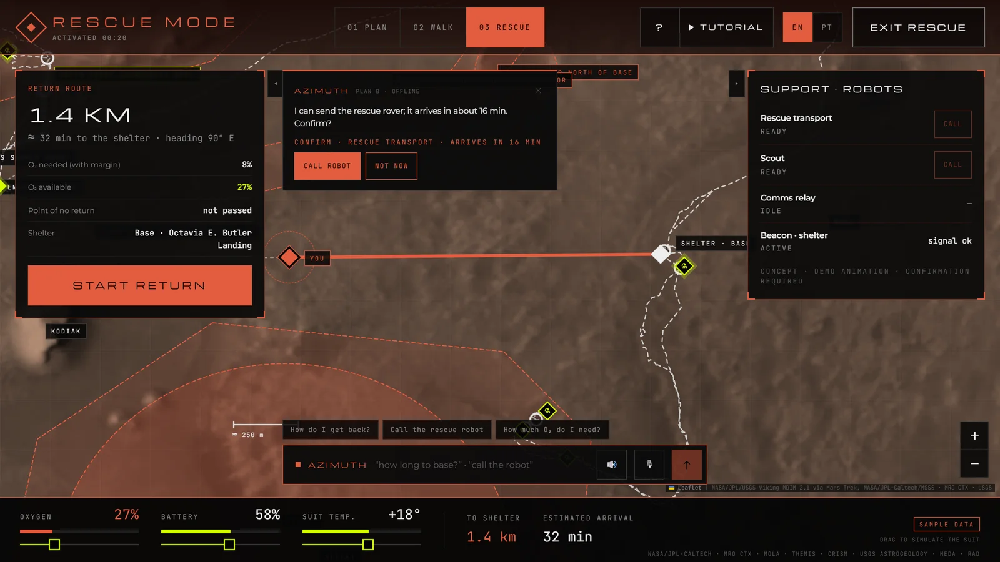

### And also

<table>
<tr>
<td width="50%">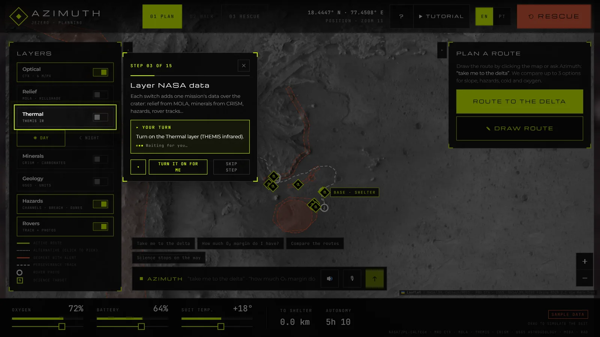</td>
<td width="50%">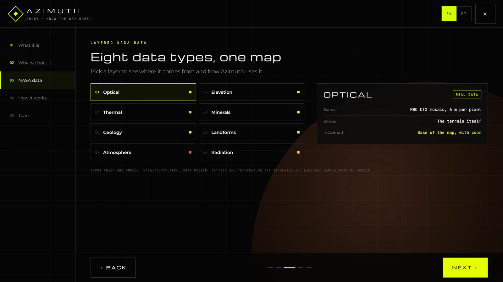</td>
</tr>
<tr>
<td><b>Interactive tutorial.</b> 15 steps on the real app. Each step waits for you to do the action, or does it for you.</td>
<td><b>About screen.</b> The eight data types, with what is real, approximate, estimated or sample.</td>
</tr>
</table>

- **3D Mars** you can rotate and zoom, before the camera dives into the crater.
- **English and Portuguese** everywhere, including alerts, dossier and AI replies.
- **Voice**: ask out loud and hear the answer (Web Speech API, in supported browsers).
- **Built for gloves**: large buttons, high contrast, alerts that stay on screen.

<div align="center">
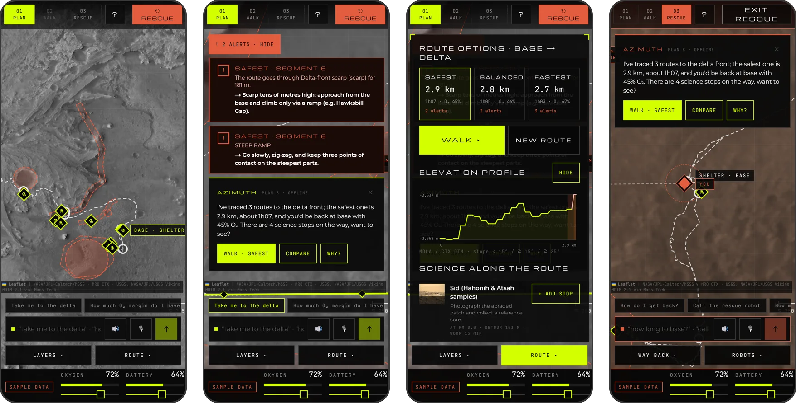
<br><sub>On phones the side panels become a bottom drawer.</sub>
</div>

## NASA data

The challenge asks for at least three kinds of data. Azimuth layers **eight**, and says on screen how far each one can be trusted.

| Data | Source | How Azimuth uses it | Status |
|---|---|---|:-:|
| **Optical** | MRO CTX mosaic, 6 m/px | Base of the map | 🟢 Real |
| **Elevation** | USGS CTX DTM 20 m · MOLA | Slope along the route and route cost | 🟢 Real |
| **Thermal** | THEMIS infrared, day and night | Compared with the suit's temperature range | 🟡 Approximate |
| **Minerals** | CRISM carbonate browse image | Mineral layer and science stops | 🟢 Real |
| **Geology** | USGS Astrogeology (SIM 3292) | Terrain context | 🟢 Real |
| **Landforms** | Named landforms of Jezero, outlined on CTX | Hazard zones the routes avoid | 🟡 Hand-digitized |
| **Atmosphere** | Perseverance MEDA | Air temperature and pressure in the dossier | 🔴 Typical values |
| **Radiation** | Curiosity RAD | Surface dose along the route | 🟡 Estimate |

Plus the **real Perseverance traverse** (1,148 points) and **13 real rover photos** (sols 46 to 762) pinned where they were taken.

<details>
<summary><b>What is simulated, approximate or a concept</b></summary>
<br>

- **Suit oxygen, battery and temperature** are simulated with sliders and labelled `SAMPLE DATA`. A real suit would feed its own sensors.
- **Surface temperature** comes from uncalibrated THEMIS brightness mapped to a plausible range. The spatial pattern is real, the degrees are not calibrated.
- **Radiation** is a Curiosity RAD estimate. Perseverance carries no dose detector.
- **Hazard outlines** were drawn by hand over CTX. One of them, the sinuous trough on the crater floor, is our own interpretation.
- **Sample-site positions** are the rover's last localized waypoint before sampling, good to tens of metres.
- **Support robots** are a concept, animated in the demo.
- Azimuth has not been tested with astronauts and is not a certified navigation tool.

</details>

## How it works

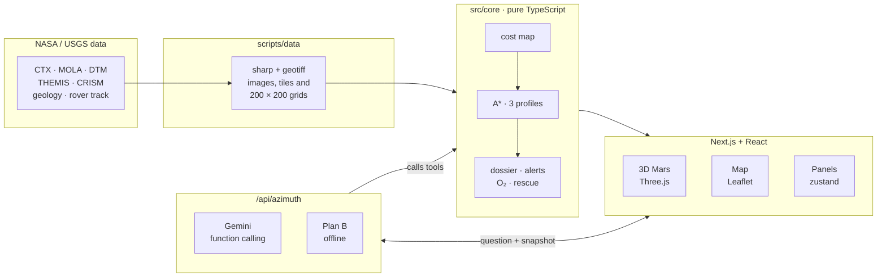

### Finding the route

Jezero becomes a 200 × 200 grid (cells of about 151 m). Every cell gets a cost factor, and A* finds the cheapest path for each profile:

```text
cost = 1 + slope² + hazard + clearance (300 m) + cold + heat − rover track
```

| Weight | Safest | Balanced | Fastest |
|---|:-:|:-:|:-:|
| Slope | 2.0 | 0.8 | 0.1 |
| Hazard | 12 | 3 | 0.2 |
| Clearance | 6 | 1.5 | 0 |
| Cold | 3 | 0.8 | 0 |
| Heat | 2 | 0.5 | 0 |
| Rover track (bonus) | 0.4 | 0.15 | 0 |

Slopes above 25° and *avoid* hazards are blocked for all three profiles. If there is no other way through, the route still passes, with a critical alert. Where Perseverance has already driven, the safest and balanced routes get a discount.

### Knowing when to turn back

```text
walking speed        = 3 km/h × (1 − 0.03 × slope°), never below 30%
oxygen               = 12% per hour, including work at science stops
point of no return   = last point where O₂ left ≥ way back × 1.3 + 10% reserve
```

All suit numbers live in [`src/config/suit.ts`](src/config/suit.ts).

## The AI that never invents a number

Azimuth is also the name of the assistant. Ask *"take me to the delta"* and it draws the routes. Three rules keep it safe:

1. **It never calculates.** It calls the site's own functions and explains the result.
2. **It suggests, the astronaut confirms**, before any action such as calling a rover.
3. **If data is missing, it says so.**

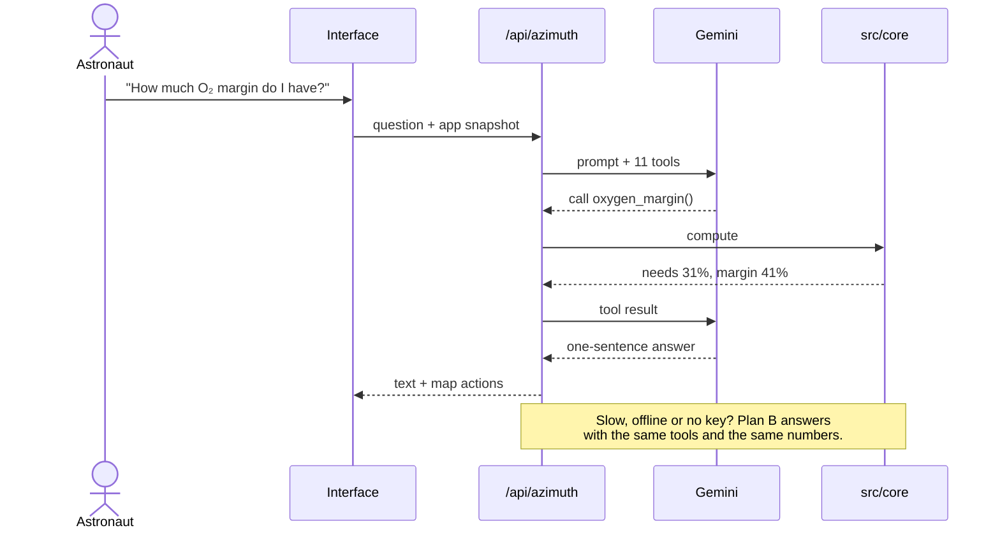

| You can say | Tool |
|---|---|
| "Take me to the delta" | `plan_routes` |
| "Compare the routes" | `compare_routes` |
| "How much oxygen margin do I have?" | `oxygen_margin` |
| "Why the alerts?" | `explain_alerts` |
| "What science is along the way?" | `science_stops` |
| "Add the Three Forks sample depot" | `add_science_stop` |
| "Show me the nearest photo" | `nearest_photo` |
| "Switch to night" | `set_time_of_day` |
| "Show me Belva crater" | `focus_map` |
| "Call the scout" | `call_rover` (asks for confirmation) |
| "Rescue, I need to get back" | `start_rescue` |

**Plan B.** If Gemini fails or takes longer than 12 seconds, or there is no API key, pre-written answers take over using the same calculations. The reply card shows `PLAN B · OFFLINE`, as in some screenshots above. The public link is protected by a limit of 12 questions per minute per IP and a 512 KB request cap, and the API key never reaches the browser.

## Run it

Requires a recent Node.js (developed on Node 24).

```bash
git clone https://github.com/leolvgomes/NSA-2026.git
cd NSA-2026
npm install
npm run dev          # http://localhost:3000
```

That is enough: the processed data is in the repository, and without a key the assistant runs on Plan B.

**To use Gemini**, copy `.env.example` to `.env.local`, paste a [free API key](https://aistudio.google.com/apikey) and restart:

| Variable | What it does |
|---|---|
| `GEMINI_API_KEY` | Enables Gemini. Read only on the server. |
| `GEMINI_MODEL` | Optional. Default `gemini-3.5-flash`, with automatic fallback models. |
| `AZIMUTH_OFFLINE` | `true` forces Plan B, useful for demos without network. |

On Vercel, set the same variables in **Settings → Environment Variables** and redeploy.

| Command | What it does |
|---|---|
| `npm run dev` | Development server |
| `npm run build` | Production build |
| `npm test` | 74 tests: routes, oxygen, rescue, AI and tutorial |
| `npm run typecheck` | Type checking |
| `npm run data:build` | Rebuilds everything in `public/data` from the original sources |

<details>
<summary><b>Rebuilding the NASA data from scratch</b></summary>
<br>

1. Download the [CTX mosaic of Jezero](https://planetarymaps.usgs.gov/mosaic/mars2020_trn/CTX/JEZ_ctx_B_soc_008_orthoMosaic_6m_Eqc_latTs0_lon0.tif) (USGS, 36 MB) into `data/raw/`.
2. Run `npm run data:build`. Everything else (terrain model, Mars Trek tiles, rover track, photos) is downloaded on demand.

| Step | Output |
|---|---|
| `ctx` | Full-resolution map image, with transparent borders |
| `dtm` | Elevation and slope grids (90th percentile per cell, on the safe side) |
| `themis` | Day and night temperature grids |
| `vectors` | Hazards, landmarks and shelters |
| `track` | Perseverance traverse |
| `derived` | Hazard and track-proximity grids |
| `layers` | Map layers, including CRISM |
| `photos` | Rover photos and their positions |
| `science` | Science targets |

</details>

<details>
<summary><b>Project structure</b></summary>
<br>

```text
src/
├── core/          route engine: cost map, A*, dossier, alerts, O₂, rescue (no React, no DOM)
├── ai/            tools, prompt, Gemini loop, Plan B, rate limit
├── app/           Next.js pages and /api/azimuth
├── components/    globe (3D Mars), map, panels, azimuth, guide (About + tutorial), layout, ui
├── state/         zustand stores
├── config/        brand, texts, suit, mission, languages
├── data/          loads public/data in the browser and on the server
└── lib/           formatting, i18n, speech, walk simulation
scripts/           NASA data pipeline and Mars textures
public/            processed data, offline tiles, textures
tests/             core, AI and tutorial tests
docs/              briefing and design sources
```

| To change | Edit |
|---|---|
| Name, texts, colors, fonts | `src/config/brand.ts` |
| About screen, team, tutorial texts | `src/config/about.ts` |
| Suit limits and consumption | `src/config/suit.ts` |
| Base, destination, map bounds | `src/config/mission.ts` |

</details>

## Beyond Mars

The method (layered orbital data, a cost map, suit limits and a return-first design) works for any place with orbital maps, such as the Moon. For the public, it is a way to explore Jezero with real NASA data and real rover photos.

## Team

**Cata-vento** · three people, one weekend.

| | | |
|:-:|:-:|:-:|
| **Leonardo Gomes** | **João Pedro** | **Maria Clara** |
| Software Engineering · *team owner* | Software Engineering | Civil Engineering |
| Architecture, NASA data pipeline, route engine, AI assistant | Interactive 3D Mars opening, About screen, guided tutorial, interface polish | Product concept and briefing, Figma design, project write-up and video |

## Credits

Imagery and data: **NASA/JPL-Caltech** · **MSSS** (MRO CTX) · **MOLA** · **THEMIS** (ASU) · **CRISM** (JHUAPL) · **HRSC** (ESA/DLR/FU Berlin) · **USGS Astrogeology** · **MEDA** (Perseverance) · **RAD** (Curiosity). Map layers served by [NASA Mars Trek](https://trek.nasa.gov/mars/). Rover photos from the [Perseverance raw images](https://mars.nasa.gov/mars2020/multimedia/raw-images/).

Azimuth is a hackathon project. It is not affiliated with or endorsed by NASA.

---

## 🇧🇷 Em português

<details>
<summary><b>Resumo do projeto e como rodar</b></summary>
<br>

**Azimuth** é um mapa em camadas da Cratera Jezero que mostra ao astronauta a rota mais segura e sempre o caminho de volta. Foi feito em um fim de semana pelo time **Cata-vento** no NASA Space Apps Challenge 2026.

- **Planejar:** desenhe a rota ou peça à Azimuth ("me leve até o delta"). O site compara três opções e cruza cada uma com o oxigênio, a bateria e a temperatura do traje.
- **Caminhar:** relógio da missão, o que vem pela frente, fotos reais do Perseverance e o aviso antes do ponto sem retorno.
- **Resgatar:** um botão, de qualquer tela, mostra a rota de volta e o abrigo mais próximo.
- **A IA não inventa números:** ela chama os cálculos do site e explica o resultado. Sem rede ou sem chave, o plano B responde com as mesmas contas.

O site abre em inglês. Para português, use o seletor **EN/PT** no topo.

```bash
npm install
npm run dev        # http://localhost:3000
```

Para usar o Gemini, copie `.env.example` para `.env.local`, cole a chave em `GEMINI_API_KEY=` e reinicie.

Dados do traje são simulados (**DADOS DE EXEMPLO**), a radiação é uma estimativa do Curiosity RAD, a temperatura da superfície é aproximada e os robôs de apoio são um conceito.

[Site](https://azimuth-nsa.vercel.app/) · [Vídeo](https://youtu.be/i6_lxfgYrVU)

</details>

<div align="center">
<br>

**[Know the way home. ▸](https://azimuth-nsa.vercel.app/)**

</div>
